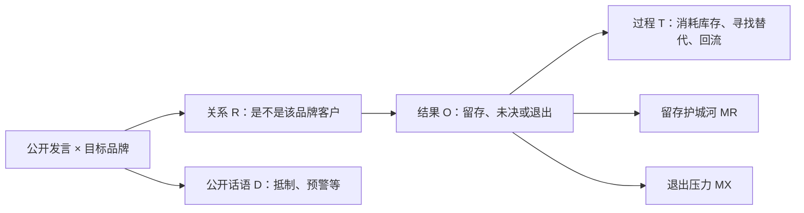
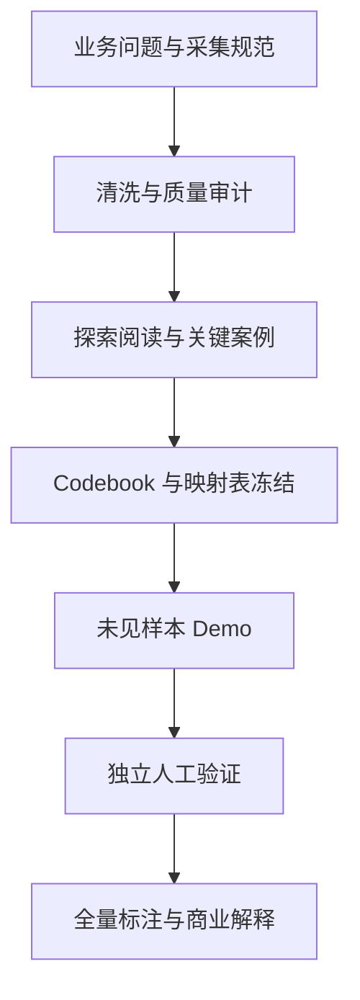

# Beauty Brand Purchase-Legitimacy Lexicon（BPLL）

## “原产国危机”下的品牌客户留存、退出与转换机制

**版本：** v2.0.1  
**更新日期：** 2026-10-12  

> 这个项目起于一个朴素的问题意识：危机发生后，网上说“不买了”的人，原本真的是这个品牌的客户吗？而那些明明担心、最后却仍然购买的人，又究竟被什么留了下来？

BPLL 是一个以中文社交媒体公开文本为材料的 Consumer Insights 项目。它从发言主体、品牌关系、消费结果、转换过程和决策机制几个层面，观察消费者为什么留下、为什么想走，以及“想走”最后有没有真的变成行动。

---

## 1. 项目要回答什么

本项目只有一个主问题：

> **当品牌因原产国事件遭遇合法性危机时，哪些目标品牌客户仍然留存，哪些客户产生退出念头或完成退出；他们分别基于什么理由作出选择？**

这里的“谁”不是问卷调查意义上的人口画像。仅凭公开文本，我们能够识别的是消费者与品牌的关系、需求结构和行为状态，例如：

- 因功效或个体适配而继续购买的既有客户；
- 想离开、却尚未找到可靠替代品的高风险客户；
- 已经决定不再复购，但仍在消耗库存的客户；
- 已经明确退出目标品牌、并验证了替代品的已执行退出者；
- 原本考虑目标品牌、因危机而放弃首购的潜在客户。

本项目无法仅通过单条发言判断一个人“永远不会离开”。所谓“留存”“退出”等词只表示文本所覆盖时点中能够观察到的消费方向。

---

## 2. 为什么这不是一次普通的舆情分析

危机舆情中最容易发生的测量错误，是把以下三种声音混为一谈：

1. **公开抵制者：** 呼吁别人不买，但没有说明自己是否用过目标品牌；
2. **潜在客户：** 没有用过目标品牌，但因危机放弃考虑或试用；
3. **既有客户：** 有目标品牌购买或使用经历，并表达继续、犹豫或退出。

三者对品牌的商业意义不同，需要处理的优先级也不同。只有“目标品牌客户关系证据”和“退出证据”同时存在，才能称为可观察的客户流失方向。抵制声量当然会制造市场压力，但我们无法据此判断客户流失，更无法直接将其作为销量下降的原因。

因此，BPLL v2 不以通用的正负面情绪作为核心指标，而是试图通过文本分析，形成一条可以核查的证据链：



---

## 3. 商业问题：品牌真正的“基本盘”是什么

原产国风险往往不是品牌通过改良单一产品就能根除的风险。对品牌而言，更有价值的问题是：

- 哪类现有客户的产品价值足以抵消危机压力；
- 哪类客户只是暂时还没走，而非真正稳定留存；
- 哪些退出压力可以通过安全证明、供应链说明或第三方检测缓释；
- 哪些压力源于对信息来源的不信任，使品牌自证失效甚至反噬；
- 哪些客户已经找到可执行的替代路径；
- 公开抵制和真实客户行为之间存在多大落差。

项目最终希望形成的，是一张能够指引客户进行危机分析的行动地图：

| 商业人群 | 文本中的识别基础 | 可能的管理问题 |
|---|---|---|
| 确认留存 | 既有客户证据 + 危机后继续购买/使用证据 | 什么构成品牌护城河 |
| 高风险未决 | 既有客户证据 + 犹豫、观望或寻找替代 | 如何降低离开压力或转换意愿 |
| 承诺退出 | 既有客户证据 + 明确不再复购 | 哪种压力已经压过产品价值 |
| 已执行退出 | 既有客户证据 + 停用、处置或实际切换证据 | 替代路径为何能够成立 |
| 潜客机会流失 | 潜客证据 + 放弃首次购买 | 危机如何影响获客，而非存量流失 |
| 公开抵制者 | 抵制/号召证据，但无个人客户行为证据 | 舆论压力多大，不能直接称为流失 |

---

## 4. 当前的机制模型

BPLL v2 将消费方向理解为“留存护城河”与“退出压力”两组力量的竞争。

### 4.1 留存护城河

- **功效与个体适配：** 产品对特定皮肤、发质或需求确实有效；
- **感官体验、习惯与情感依恋：** 使用体验熟悉，或已经形成稳定惯例；
- **转换风险：** 更换产品可能带来试错、过敏、无效或额外成本；
- **替代品稀缺：** 市场上没有同等有效或同等适配的替代；
- **可信的风险缓释：** 产地、批次、检测或渠道证据被消费者接受；
- **风险普遍化：** 消费者认为排放污水带来的环境风险不可避免，因而不改变购买；
- **消费决策自主：** 消费者不愿让政治或群体压力决定私人选择。

### 4.2 退出压力

- **产品安全与健康风险；**
- **检测信息、企业或监管信任崩塌；**
- **原产国连带与“日本属性”污染；**
- **通过不购买惩罚企业、进而向日本政府施压；**
- **国家身份与道德义务；**
- **继续购买所承受的社会惩罚与负面身份信号；**
- **危机前产品价值本就不足；**
- **替代品的吸引力与可获得性。**

### 4.3 转换可执行性

我们注意到，“想离开”并不等于“已经离开”。有许多用户一边说不买了，一边还在用库存；有人已经开始找替代，却试了几轮都不合适；也有人换成功以后再也没有回来。
库存、搜索、试用、成功、失败和回流是不同阶段，因此本项目将**消费结果**与**转换过程**分开编码。

本研究存在一个待检验的猜想：

> **退出压力是否转化为实际退出，不仅取决于消费者有多不满，也取决于替代路径是否存在且是否已经被验证。**

---

## 5. 探索阶段形成的待检验洞察

120 条探索样本帮助我们看见了语料的大致形状，随后选出的 60 条关键案例则专门用来处理最容易吵起来的边界。研究者逐条复核后形成了下面几条判断。

1. **“好用”不等于“会留下”。** 有人确实因为效果无可替代而继续购买，也有人一边承认好用，一边决定用完库存就走。
2. **安全担忧与信任崩塌经常相互强化。** 部分消费者不仅担心风险本身，也怀疑企业或检测机构有隐瞒、逐利的动机，更有人认为自证的背后是“此地无银三百两”。
3. **“日本”同时可能是风险来源、惩罚对象和负面身份信号。** 不购买既可能是风险规避，也可能被理解为向企业或政府施压，以及履行身为“中国人”身份认同的道德义务。
4. **公开抵制与能够直接证明的客户退出是两个不同集合。** 一个人可以积极要求别人抵制，却从未是目标品牌客户；两者的总体规模关系仍待正式抽样分析。
5. **替代品决定退出能否落地。** 寻找替代、替代成功、替代失败与是否回流需要分别观察。
6. **品牌自证不一定有效。** 当消费者不信任信息来源时，更多的安全说明可能是无效的，甚至有被理解为“为了卖货而自证”的反效果。

项目最初有一个很强的直觉：化妆品具有社交货币属性，所以当“日本”从正面标签翻转为负面标签时，品牌的社会价值也会一起受损。读完这一轮材料后，这个想法没有被丢掉，但需要说得更准确：当前文本最直接支持的是，**原产国属性在危机中可能转化为负面身份信号和社会惩罚依据。** 至于化妆品是否比药品更依赖社交货币，还需要另外的跨品类材料才能回答。

---

## 6. v2 相比 v1 改了什么

如前所述，v1 真正的问题，将购买理由、危机反应、心理状态、转换行为和样本资格等不是同一层级的内容压缩到了一起。它们可以同时成立，却曾被要求在相同层面竞争位置。由于题目本身的问题，致使标注者们对是否给出同一标签存在较大的异议。

因此，我们在v2 中重新分层，让每一层只负责回答一个问题。

| v1 | v2 |
|---|---|
| 价值型 / 信号型二分 | 品牌关系—结果—过程—机制 |
| 负面表达容易与客户流失混合 | 公开话语与个人消费结果相互独立 |
| “替代转投”等标签同时包含原因和行为 | 结果 O 与转换过程 T 分开 |
| 单层多标签承担过多任务 | 每一层只回答一个测量问题 |
| 以关键词词典自动命中为主要方向 | 以 Codebook 约束的 LLM 结构化标注为主要方向 |
| 旧人工标注可直接验证旧词典 | 旧标注仅作历史开发材料，不是 v2 的 gold set |

完整定义、排除规则与案例见 `docs/codebook_v2_中文版.md`。

### 注意事项：关于项目名中的 “Lexicon”

BPLL 最初以关键词词典为主要交付，因此沿用了 “Lexicon” 这个名字。到了 v2，项目核心已经更接近一套**有证据约束的消费行为编码框架与 LLM 标注pipeline**。目前暂时保留 BPLL 作为项目名。

---

## 7. 数据与研究范围

### 7.1 案例与平台

研究以 2023 年福岛第一核电站 ALPS 处理水排海事件为危机节点，分析微博与小红书上围绕相关美妆及日化品牌的公开发言。语料按事件前基线、事件爆发期和后续冷却期组织。

| 语料 | 现有规模 | 结构 | 在 v2 中的角色 |
|---|---:|---|---|
| 微博原始数据 | 31,677 条 | 5 个品牌 × T0/T1/T2 | 清洗与抽样来源 |
| 微博普通用户主样本 | 5,370 条 | 资生堂、SK-II、花王、珀莱雅、蜂花 | 未来全量结构化标注主体 |
| 小红书 | 60 条主贴 + 700 条评论 | 单一品牌，无统一时间切片 | 质性补充与表达发现 |
| v2 探索样本 | 120 条 | 平衡扫描 + 危机富集 | 概念发现，不估计总体比例 |
| v2 关键案例 | 60 条 | 目的性抽取的边界与分歧案例 | 规则重建，不作为测试集 |

微博主样本中，热门评论为 3,525 条，主贴正文为 1,845 条；明确命中危机词簇的发言约占 9.8%。因此，开发与验证样本会适度富集危机文本，同时保留抽样来源标记，避免将富集样本误作总体分布。

### 7.2 v2 的当前主范围

现阶段首先用资生堂、SK-II、花王三个日系目标品牌的 T1/T2 文本稳定危机行为模型。T0 可用于识别常态购买价值，珀莱雅与蜂花可作为对照或替代讨论背景。

### 7.3 项目分工与研究者贡献

原始帖子与评论的抓取由外部协作者执行，研究者提供并审核：

- T0/T1/T2 时间框架；
- 品牌、帖子、评论与互动等字段要求；
- 数据清洗和排除标准；
- 核心业务问题与研究假说；
- 探索阅读、关键案例裁决与 Codebook 重建；
- LLM 标注、人工验证、统计分析和商业解释方案。

LLM 主要承担代码辅助、概念整理与批量标注。研究问题为什么这样问、类别为什么这样拆、哪一条可以进入 reference annotation，以及分歧最后怎么裁决，仍由研究者负责。每次模型运行都会保留模型版本、日期、输入、Codebook 版本和原始输出。

---

## 8. 研究流程



### 8.1 数据清洗

微博清洗的原始文件保持不变，被排除的重复、广告、低信息、误命中与其他噪声分别进入归档，并保留排除规则。机构/媒体账号与普通用户分流，不混合计算。

现有 `clean_weibo.py` 已在 Windows 与 Ubuntu 环境独立运行；主样本文件哈希及逐字段汇总一致。详见 `reports/cleaned_weibo/dq_report.md` 与 `reports/VERIFICATION.md`。

### 8.2 探索与模型建立

- 120 条探索样本用于理解语料、发现机制和检验研究问题是否可测；
- 60 条关键案例用于集中处理最容易混淆的品牌关系、公开抵制、潜客、库存和替代状态；
- 两组材料均已进入设计过程，因此不会用于最终盲测或宣称模型准确率。

### 8.3 Codebook v2

每条记录的分析单位为：

> **一条社交媒体发言 × 数据行指定的目标品牌**

核心字段如下：

| 字段 | 形式 | 回答的问题 |
|---|---|---|
| V 声音来源 | 单选 | 行为判断来自本人、被转述个人、机构还是未知来源 |
| R 目标品牌关系 | 单选 | 发言主体是目标品牌既有客户、潜客、其他品类用户还是无法确认 |
| O 消费结果 | 单选 | 文本证明了留存、未决、退出意图、退出执行、潜客流失或无个人结果中的哪一种 |
| T 转换过程 | 多选 | 是否处于库存、寻找替代、试用、成功、失败、处置或回流阶段 |
| MR 留存护城河 | 多选 | 什么力量支持留存 |
| MX 退出压力 | 多选 | 什么力量推动退出 |
| D 公开话语行为 | 多选 | 是否在公开抵制、道德惩罚、风险预警或劝购 |
| E 证据 | 原文片段 + 等级 | 每个标签由哪段文本直接支持 |

### 8.4 LLM Demo 与独立验证

Codebook 与映射表冻结后，项目已从未参与 120 条探索样本和 60 条关键案例的语料中抽出 36 条新文本，用作第一轮 demo：

1. 研究者先独立制作 reference annotation；
2. reference 在查看模型结果前冻结；
3. 外部 LLM 在全新、无项目历史的对话中盲标；
4. 同一模型独立运行三次，检查模型自洽性；
5. 先计算一致性，再逐例分析错误；
6. 若 Codebook 因分歧而修改，旧 demo 降为开发集，并重新抽取 holdout。

第一轮候选外部模型为 Gemini，理由是它未参与旧版分类或 v2 重建，可降低设计谱系污染。正式运行时以实际模型名称和版本记录为准。

首轮门槛如下；36 条仅用于发现工作流故障，标签在结果中若数量稀少，则不凭少数样本判定通过或失败。

| 评估对象 | 指标 | 暂定门槛 |
|---|---|---|
| 目标品牌关系 R | 原始一致率、Gwet’s AC1 | agreement ≥ 0.90；AC1 ≥ 0.80 |
| 消费结果 O | 原始一致率、Gwet’s AC1 | agreement ≥ 0.85；AC1 ≥ 0.80 |
| 既有客户退出/非退出 | precision、recall、F1 | precision 与 recall 均 ≥ 0.85 |
| 转换过程 T | micro-F1、Jaccard | micro-F1 ≥ 0.80；Jaccard ≥ 0.75 |
| 机制 M | micro/macro-F1、逐标签 F1 | micro-F1 ≥ 0.80；正例充足标签 F1 ≥ 0.70 |
| 三次重复 | 同组指标 | 自洽性不得明显低于模型—研究者一致率 |

### 8.5 真人验证

36 条 demo 阶段不立即消耗第二位真人标注者。Codebook 冻结并通过首轮工作流检查后，计划邀请一名未参与 v1 的标注者，独立完成至少 60 条、优选 100–120 条与研究者重叠的文本。先报告人—人一致率，再公开记录分歧裁决；最终 gold set 指裁决后的版本，不等同于任何单一标注者的答案。

---

## 9. 项目状态

截至 2026-10-12：

| 工作项 | 状态 | 能否用于正式结论 |
|---|---|---|
| 原始数据与字段规范 | 已完成 | 仅作为数据基础 |
| 微博清洗、分流与质量报告 | 已完成并跨环境核对 | 可以说明处理流程与样本规模 |
| v1 关键词词表与审计 | 已完成的历史资产 | 不能替代 v2 验证 |
| v1 试标及部分正式批次 | 历史开发材料 | 不是 v2 gold set |
| 120 条探索阅读 | 已完成 | 只支持概念发现 |
| 60 条关键案例复核 | 已完成 | 只支持规则重建 |
| Codebook v2 中文版 | 已审核并冻结为 v2.0.1 | 可作为首轮 Demo 的固定规则 |
| README v2 中文版 | 已完成 | 可用于说明当前设计与进度 |
| 品牌/产品昵称映射 | 109 条映射与 5 条范围裁决已冻结 | 可用于品牌关系判断，但不能替代购买史证据 |
| JSON Schema 与盲标 Prompt | 已冻结；结构版本为 2.0 | 可用于外部模型三次独立运行 |
| 36 条未见样本 demo | 研究者 reference 已完成并在模型运行前冻结 | 仅作为自然分布筛查 Demo；暂无模型准确率可报告 |
| 独立真人验证 | 尚未执行 | 无最终 gold set |
| 全量 LLM 标注 | 尚未执行 | 无总体分布结果 |
| 品牌 × 时段分析与商业建议 | 尚未执行 | 无最终研究结论 |

当前仓库中的 v1 结果与 v2 无关。v2 的正式结果只有在 Codebook 冻结、独立验证达标并留下完整运行记录后才会发布。

---

## 10. 计划交付物

| 交付物 | 作用 | 当前状态 |
|---|---|---|
| Codebook v2 | 冻结定义、边界、正反例与证据规则 | v2.0.1 已冻结 |
| 品牌别名与产品映射 | 稳定目标品牌关系判断 | 已审核；`brand_alias_map.csv` 已冻结 |
| 固定 JSON Schema 与 Prompt | 约束 LLM 输出 | 已冻结；Schema 结构版本 2.0 |
| Demo 数据与评估报告 | 检查模型一致性、错误类型与可复现性 | 36 条 reference 已冻结；等待三次 Gemini 盲标 |
| Human validation set | 检查定义能否被独立真人理解 | 待执行 |
| v2 结构化标注数据 | 支持品牌、时段、内容类型与机制分析 | 待执行 |
| Consumer Insights 报告 | 将留存、退出、替代与舆论差距转化为商业建议 | 待执行 |
| 可派生词表/规则 | 对高精度表达进行轻量筛选或检索 | 是否保留待评估 |

---

## 11. 这个项目真正想展示什么

BPLL真正想展示的是：研究者能够把一个模糊的商业现象，逐步变成可测量、可验证、最后也能转成业务判断的问题。这个业务闭环包括：

- 从模糊商业现象中提出可回答的决策问题；
- 设计时间窗口、字段、样本边界与数据清洗要求；
- 通过探索阅读从个案叙述中抽象机制；
- 将机制转化为互斥/多选字段、证据规则与可计算指标；
- 识别公开舆情、潜客流失与既有客户流失之间的测量差异；
- 用独立标注、重复运行和 holdout 检查 LLM 的稳定性；
- 把文本模式解释为客户基本盘、转换障碍与危机沟通选择；
- 对隐私、平台偏差、推断边界与模型局限作透明说明。

---

## 12. 可复现性与版本控制

正式 v2 工作流将保存以下信息：

- Codebook 版本号及变更记录；
- 抽样规则、随机种子与开发集/测试集 ID；
- 模型供应方、模型名称、运行日期与对话设置；
- 完整 system/user prompt、JSON Schema 与原始输出；
- 每条标签对应的证据片段；
- 每次重复运行结果、一致性指标和错误分类；
- 人工 reference、独立标注与裁决日志；
- 正式分析输入摘要哈希与运行日志。

现有清洗与 v1 管线的跨环境验证记录见 `reports/VERIFICATION.md`。v2 的模型评估与全量标注将生成独立的验证报告，不沿用 v1 的性能数字。

---

## 13. 数据可获得性与伦理边界

本项目处理的是公开社交媒体文本，但公开可见不等于适合重新分发。对外仓库原则上只公开：

- 研究设计、Codebook 与方法说明；
- 数据清洗、抽样、评估与聚合脚本；
- 不含可追溯原文的结构说明、指标与聚合结果；
- 经必要脱敏或改写、且不支持反向检索的示例。

原始帖子、评论、用户标识及可定位单条发言的工作文件不默认公开。详细规则见 `DATA_AVAILABILITY.md`。

---

## 14. 研究边界

1. **公开发言不等于总体消费者。** 沉默客户、私域讨论和未被关键词命中的内容不可见。
2. **文本陈述不等于交易记录。** 本项目识别的是文本中可观察的行为方向，不能直接估算真实留存率、流失率或销量。
3. **发言是分析单位，不追踪自然人。** 同一用户可能在不同时点表达不同立场，本项目不据此建立人格或永久客户分类。
4. **开发样本不能估计比例。** 120 条探索样本和 60 条关键案例经过平衡或目的性选择。
5. **社交货币解释尚未被跨品类验证。** 药品与化妆品的反差是研究缘起，不是本数据能够单独裁决的结论。
6. **品牌销量下降存在多重原因。** 市场竞争、渠道、价格、产品周期与宏观消费环境均可能同时作用；社媒文本不能建立危机对销量的因果效应。
7. **LLM 一致不等于概念有效。** 模型可以稳定复现错误，因此仍需 evidence span、独立人工检查和商业常识复核。
8. **模型会变化。** 聊天产品难以完全锁定采样参数，必须记录版本并使用重复运行检查稳定性。
9. **短文本和缺失上文限制判断。** 无法确认品牌关系或个人行为时，应保留“不足以判断”，而不是强行补全。
10. **平台不可直接合并。** 微博与小红书的内容结构、用户和推荐机制不同，应分平台解释。

---

## 15. 目标仓库结构

以下为 v2 合并后的目标结构；标注“历史”的内容只保留作迁移与审计，不参与 v2 正式结论。

```text
README.md                         # v2 项目首页
METHODS.md                        # v2 方法说明与正式运行规则
DATA_AVAILABILITY.md              # 数据公开与隐私边界
CHANGELOG.md                      # 版本修改记录
.gitignore                        # 私有语料、reference 与模型运行排除规则
docs/
  codebook_v2_中文版.md           # v2.0.1 冻结版编码手册
  annotation_schema_v2.json       # LLM 输出结构
  prompt_v2.md                    # 冻结版模型指令
  brand_alias_map.csv             # 目标品牌—产品—别名映射
  brand_scope_decisions_v2.csv    # 品牌边界裁决
  gemini_blind_annotation_manual.md # Gemini 三次盲标手册
  validation_protocol_v2.md       # 验证设计与指标
templates/
  annotation_template_v2.xlsx     # 不含真实原文的公开模板
examples/
  synthetic_input.json            # 合成输入示例
  synthetic_annotation_example.json # 合成结构化输出示例
scripts/
  validate_annotation_json.py     # Schema 与记录完整性检查
  evaluate_v2.py                  # 一致性与错误分析
reports/
  validation_v2/
    README.md                     # 当前验证状态；不含原文
archive/
  v1/                             # 历史编码手册与标注指南
```

---

## 16. 下一步

1. 研究者 reference 已在查看任何模型结果前冻结；
2. 按 `docs/gemini_blind_annotation_manual.md` 在三个互不共享上下文的新对话中运行 Gemini，保存模型名称、日期、Prompt 与原始 JSON；
3. 计算研究者—模型一致性与三次模型自洽性，并逐例检查错误；
4. 根据错误类型决定通过、修订 Codebook 或把本轮 Demo 降为开发集后重抽 holdout；
5. Codebook 稳定后开展独立真人验证；
6. 达标后再进行全量标注、品牌 × 时段分析和商业建议。

---

## 17. 版本记录

| 版本 | 日期 | 说明 |
|---|---|---|
| v2.0.1 | 2026-10-12 | 冻结首轮研究者 reference；澄清 D2 门槛、间接 R1 证据与 T4 成功标准；同步品牌映射、盲标手册与公开文件边界 |
| v2.0 | 2026-09-08 | 建立“目标品牌关系—消费结果—转换过程—留存/退出机制—公开话语”的新骨架，替代 v1 的购买合法性二分主框架 |
| v1.0–v1.1 | 2026-07 | 关键词词典、两层话语类别、旧版人工标注与安慰剂分析管线；作为历史设计保留 |
